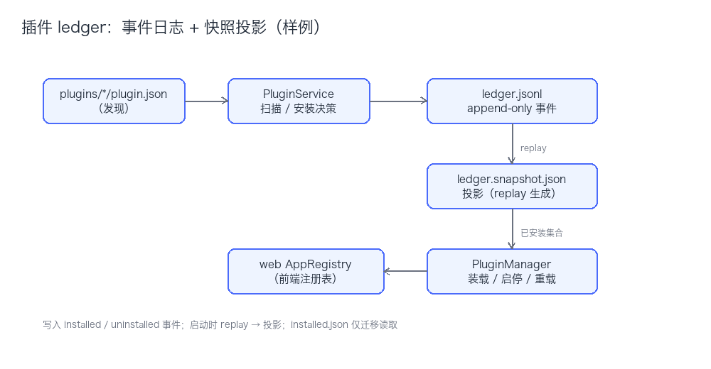

# 插件 ledger：事件日志 + 快照投影

> 状态：草案（2026-10-17）｜对应实现：`server/app/ledger.py`、`server/app/plugin_service.py`、`server/app/plugin_manager.py`
> 本文件是 `design/` 的样例，演示「文档 + 同名 drawio 图 + 状态行」的写法，内容按实际方案替换。

## 背景

早期用 `server/data/installed.json` 记录已安装插件，整文件覆盖写：没有审计记录，进程在写入过程中崩溃可能留下截断文件，多个入口并发写会互相覆盖，排障时只能看到最后状态。

## 方案

1. **事件日志**：`ledger.jsonl` 只追加，事件为 `installed` / `uninstalled`，一行一条，写完即落盘。
2. **投影**：`ledger.snapshot.json` 保存当前已安装集合；启动时 replay 事件文件得到最新状态，读路径不解析全量日志。
3. **职责拆分**：`PluginService` 负责扫描、安装决策与 ledger 写入；`PluginManager` 负责装载 / 启停 / 重载。二者通过投影解耦，前端清单由 Service 提供。
4. **迁移**：首次运行读取旧 `installed.json`（默认 `["notes", "explore"]`）导入为初始事件，随后改名为 `.json.bak`，不再读取。
5. **压缩**：事件文件超过阈值时，把当前投影写成快照，并把事件文件轮转为 `ledger.jsonl.<ts>.bak`。

## 取舍

| 方案 | 优点 | 代价 |
|---|---|---|
| `installed.json` 覆盖写 | 实现最简单 | 无审计、崩溃易损坏、并发丢写 |
| append-only + 投影（本方案） | 可审计、可 replay、写入原子 | 需要压缩与迁移逻辑 |

## 待定

- [ ] 压缩阈值按事件条数还是文件大小，取值多少
- [ ] 快照与日志不一致时的修复流程，是否纳入 `python -m app.cli doctor`
- [ ] 卸载级联记录保留多久，是否需要单独的清理命令

## 相关

- 架构正典：`ARCHITECTURE.md`（第 8 节 插件内核）
- 字段契约：`docs/PLUGIN-SPEC.md`
