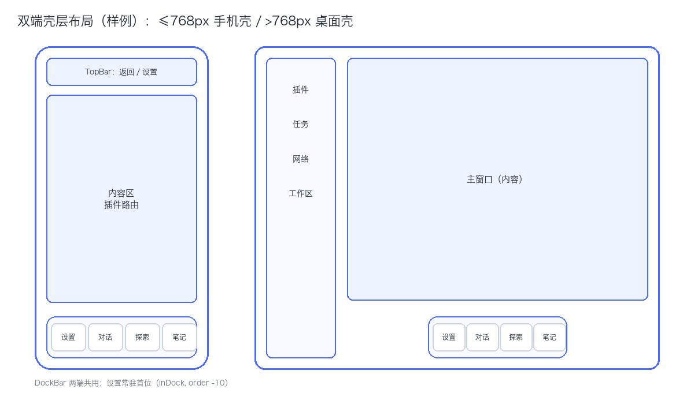

# 双端壳层布局

> 状态：草案（2026-10-17）｜对应实现：`web/src/App.vue`、`web/src/components/DockBar.vue`
> 本文件是 `design/` 的样例，演示 UI 设计稿的写法，内容按实际方案替换。

## 断点

| 宽度 | 壳层 | 结构 |
|---|---|---|
| ≤768px | 手机壳 | TopBar（返回 / 设置）+ 内容区 + 底部 DockBar |
| >768px | 桌面壳 | 左侧 SideBar（插件 / 任务 / 网络 / 工作区）+ 主窗口 + 底部居中 DockBar |

## DockBar

- 两端共用同一个组件与同一份注册表，不做两套实现。
- 设置常驻首位（`inDock: true`、`order: -10`），其余为 对话 / 探索 / 笔记。
- 卸光应用插件后进入 EmptyHome 空态，只剩系统插件入口。

## 约束

- DockBar 贴底，并避开系统手势区 / 安全区，不被遮挡。
- 新增形态差异只在 `App.vue` 的唯一分支里加，不复制两套壳。
- 图标、圆角、间距复用 Tailwind 语义类，不写一次性魔法值。

## 待定

- [ ] 平板竖屏（768–1024px）是否需要 SideBar 收起态
- [ ] Dock 项超过 5 个时的溢出策略（横向滚动 / 更多菜单）
- [ ] 桌面主窗口是否支持多窗口并排

## 相关

- 架构正典：`ARCHITECTURE.md` §4.1 布局调度
- 交互原型：`design/settings-master-detail.html`
