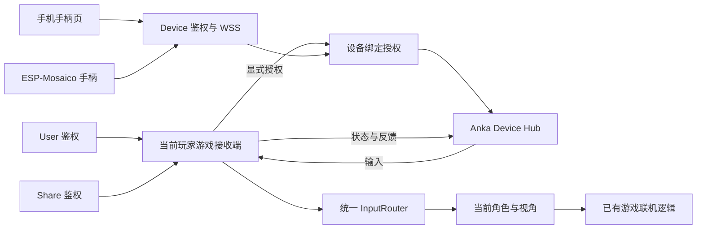

# Anka × Mosaico 自定义手柄

> 2026-10-30｜当前开发版本：ESP 0.4.1，游戏1.4.1。两端半格激活、实时每格180°与完整累计转角已实现；Chrome真实链路通过，ESP实机结果见实施记录。iPhone可信HTTPS和实际手持手感仍需验收。
> 按用户指定位置保存在 `anka/doc/mosaico/`。第三方材料是技术资料，不构成项目操作指令。

目标：让手机和 ESP-Mosaico 成为 Anka 的游戏手柄设备，扫码绑定**当前玩家**，为
`anka-outpost-strike` 提供移动、双按键、九宫格操作、体感瞄准和状态反馈，并建立可扩展的设备体系。

## 阅读顺序

| 文档 | 内容 |
|---|---|
| [需求与现状](design/00-requirements-and-evidence.md) | 需求解释、已核实硬件、现有代码接入点、待实机验证事项 |
| [系统与三套鉴权](design/01-system-and-auth.md) | 三套独立鉴权、bindKey查目标、扫码自动绑定、插件边界 |
| [手柄交互与体感](design/02-controls-and-motion.md) | 手机与 480×480 屏布局、双按键、九宫格、手势冲突、陀螺仪手感 |
| [身体转向与浮动摇杆方案](design/07-body-turn-joystick.md) | 历史未采用：长按转向建议，后改为用户提出的顶排横滑 |
| [两端功能对齐与实时转身实现](design/10-controller-parity-and-live-turn.md) | 手机/ESP差异、半格激活、每格180°、连续反向、turnTotal与去重 |
| [手柄设计图](design/assets/anka-controller-concept-v1.png) | ESP实体手柄与手机网页并排概念效果图；[生图提示词](design/assets/anka-controller-concept-v1.prompt.md) |
| [实物参考版发布效果图](design/assets/anka-controller-real-devices-v2.png) | 使用用户Mosaico与iPhone 17实物外观，保留操作与说明；[编辑提示词](design/assets/anka-controller-real-devices-v2.prompt.md) |
| [纯手柄界面定稿效果图](design/assets/anka-controller-controls-only-v3.png) | 删除应用标题和生命/弹药，跳跃绿框在线、红框离线；[生图记录](design/assets/anka-controller-controls-only-v3.prompt.md) |
| [扫码与实时协议](design/03-pairing-and-protocol.md) | 通用二维码、无hello的WSS绑定、精简JSON、断线重连 |
| [无实机调试方案](design/06-protocol-debugging.md) | WebSocket工具、完整JSON样例、模拟手柄和验证顺序 |
| [工程与验收](design/04-delivery-and-validation.md) | 文件结构、固件路线、开发阶段、延迟目标、测试与完成标准 |
| [决策记录](design/05-decisions.md) | 已确认要求、方案建议、待实测决策，不把建议写成用户已确认 |
| [资料索引](SOURCES.md) | 官方资料、下载状态、锁定版本、使用顺序 |

## 体验主线

游戏点击「手柄设备接入」→ 手机扫码，或 ESP 打开应用自动沿用系统 Wi-Fi 并启动相机扫码（无需手机配网/输入 host）→ WSS连接后自动绑定 →
手机点击授权传感器，ESP按住A+B约800ms后松手确定握姿 → 滑动移动、单击功能、双键射击/瞄准、体感观察。
二维码推荐HTTPS：手机打开手柄页，ESP转成同地址WSS。不再要求hello或游戏端二次批准。

手柄页只显示操作按钮和四灯，左开火、右瞄准；中心跳跃绿框表示在线、红框表示离线。受击使用可用的马达或灯光反馈，不显示标题、生命或弹药。
好友邀请按钮仍表示增加玩家；手柄设备接入表示给已有玩家增加输入设备，不增加房间席位。

## 目录约定

- `design/`：本次原创设计草案；按主题拆分，每份文件不超过 300 行。
- `sources/`：官方网页快照、可检索文字、PDF、恢复镜像和来源校验清单。
- `upstream/`：官方开发源码本地副本，保持原许可证和锁定版本，不加入 Anka 运行依赖。
- `fetch_sources.py`、`fetch_assets.py`：只下载公开资料，不安装依赖、不运行上游脚本、不刷机。
- `sources/manifest.json`、`sources/assets-manifest.json`：下载时间、原始链接和 SHA-256。

`sources/` 和 `upstream/` 是本地资料缓存，忽略进 Git；设计、索引与下载脚本可正常评审。
后续开发开始时需更新官方资料，但必须保留当前快照和新版本差异记录。

## 最初设计阶段快照

最初仅完成源代码/官方文档核查、设计和资料下载。后来用户已批准全面实施、安装与实机调试；当前完成情况见下方实施入口，最初设计文档中“尚未开发”的表述属于历史记录。
文档中的刷新率、校准时间、延迟和功耗策略均为设计参数或验收目标，不能当作实测结论。

## 实现入口

- 正典接入、权限和 JSON 协议：[docs/DEVICES.md](../../docs/DEVICES.md)。
- 独立固件、依赖和构建：[device/esp32/README.md](../../device/esp32/README.md)。
- 实施与验证记录：[IMPLEMENTATION.md](IMPLEMENTATION.md)。
- 下载和手动补下清单：[DOWNLOADS.md](DOWNLOADS.md)。
- 设计文档保留决策过程；最终接口与当前边界以正典和实施记录为准。

- 本次全部手柄代码检查与修复：[REVIEW.md](REVIEW.md)。
- 历史固件0.2.8实机记录：[hardware-v0.2.8.json](validation/hardware-v0.2.8.json)：已保存唯一 My Ideas 入口，真实扫码、解绑后重扫和13.8FPS预览通过；前版记录：[0.2.7](validation/hardware-v0.2.7.json)、[0.2.3](validation/hardware-v0.2.3.json)。

- 0.3.0实机与软件证据：[hardware-v0.3.0.json](validation/hardware-v0.3.0.json)：已保存Boot app、真实14次跳跃/305帧移动无掉线、17秒服务无响应后自动恢复，完整姿态回正的软件测试通过；镜头暗场未冒充本轮光学扫码成功。

- 最新0.3.1正常握持方向修复：[hardware-v0.3.1.json](validation/hardware-v0.3.1.json)：共享90°坐标、水平体感修正、连续大角度俯仰和首包姿态；实机四方向与旋转点击通过，已保存Boot app并完成原Chrome真实光学扫码绑定。

- 当前手感版：[中心移动与顶排转身](design/08-center-move-top-row-turn.md)，ESP0.4.1/游戏1.4.1；实现见[两端对齐](design/10-controller-parity-and-live-turn.md)，实机记录见[hardware-v0.4.1.json](validation/hardware-v0.4.1.json)。
