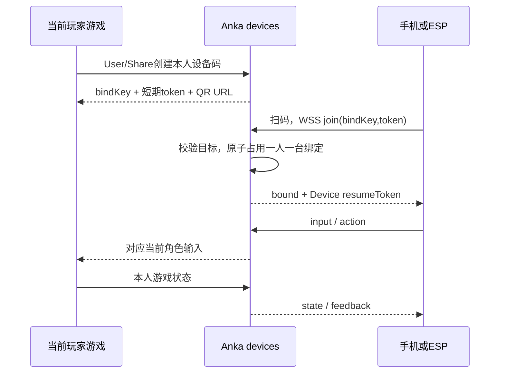

# 系统架构与 User / Share / Device 三套鉴权

> 草案修订｜2026-10-28｜保留三种独立身份，精简为「扫码自动绑定、一人一台」。
> 配对/重连地址和控制字段以[实时协议](03-pairing-and-protocol.md)为准。

## 1. 独立鉴权，明确授权

| 体系 | 凭证与验证 | 允许范围 | 不允许 |
|---|---|---|---|
| User | anka_session / auth.current_user | 账号业务、本人游戏、生成自己的设备码/解绑 | 别人的角色控制权 |
| Share | anka_guest_session / Share专用校验器 | 指定房间本人席位、给本人生成设备码/解绑 | 账号业务、其他席位 |
| Device | join的bindKey+token，之后resumeToken | 当前绑定目标输入、有限反馈 | User/Share身份、账号接口、房间管理 |

生成二维码属于User/Share显式授权，短期配对凭证只在Device入口生效。
设备不使用玩家Cookie，不把User token或Share邀请码放进二维码。
Device路由忽略顺带携带的User/Share Cookie，缺设备凭证即拒绝；反向也不互认。
三类验证器、凭证命名空间和权限独立，可复用密码学基础库，不共用「认证成功就登录」入口。

## 2. 绑定流程

不再要求设备hello、capabilities、领取WS ticket或游戏端二次批准。
持有本次二维码即可绑定；以短期、单次、已绑定禁开新码控制范围。
手机陀螺仪权限仍需用户交互，由手机页面处理，与绑定二次批准无关。

## 3. 服务端最小状态

| 对象 | 关键内容 | 本期处理 |
|---|---|---|
| 配对请求 | bindKey、token_hash、授权来源、player_key、app/room/runtime、到期时间 | 120秒，消费或换码失效 |
| 活跃绑定 | deviceId、player_key、target、resume_hash、授权引用、期限 | 一玩家一条，仅当前游戏上下文 |
| 设备连接 | 活跃socket、最后seq、最后有效input时间 | 身份保存在连接上下文，无需每帧重传 |
| 游戏接收端 | 当前实例连接、前台状态、最后存活时间 | 只向本人活动实例投递，不存离线输入 |
| 输入缓存 | 最新move/buttons、累计look、有限action队列 | 断线/暂停/撤权清空 |

沿用现有单worker部署，服务内锁和有界内存状态完成创建、消费与唯一绑定。
不新建持久设备账号、devices.sqlite3、设备历史管理或跨重启凭证恢复。
服务重启绑定失效，重新扫码；当前房间体系也不恢复跨重启比赛。
以后需要持久设备注册再单独设计，不提前增加本期字段与流程。

## 4. bindKey定位当前玩家

User和Share路径分别鉴权，把已解析好的本人目标存进配对请求。
单人目标为app+本人+runtime；联机为app+room+本人actor+runtime。
Share只能绑本人角色；设备提交playerId/roomId不参与权限判定。
player_key使用规范化玩家标识，不包含runtime_id，同一玩家另开标签页不能绑第二台。
设备只看到必要显示信息，不返回账号/Share凭证或其他玩家数据。

新房间、新游戏实例需要重扫；同一大厅进入同一局可保持绑定，但清空输入。
角色外观变化不等于目标变化。页面刷新按现有runtime结束处理，本期重新扫码，
不引入接收端接续ticket与租约迁移协议。

## 5. 凭证与撤销

| 项目 | 初始建议 |
|---|---|
| bindKey | 128位随机索引，不是单独凭证 |
| 配对token | 256位随机秘密，120秒有效，一次消费 |
| resumeToken | 独立256位随机秘密，与绑定同寿命 |
| 活跃绑定 | 最长12小时，不超过父授权，目标结束立即失效 |
| 设备输入 | 150ms无有效input即释放，不能用3秒心跳代替 |

服务端只保存凭证哈希，不从User/Share凭证派生设备凭证。
本期手机与ESP仅在当前页面/应用内存保留resumeToken，不写长效Cookie/localStorage/NVS。
退出页面/重启应用后重新扫码；Wi-Fi配置、设备设置与IMU校准可独立存NVS。
短暂断网用resumeToken重连，原join token不复用，先停旧连接再启新连接。

User登出/账号失效、Share到期/离房/被踢、房间关闭、插件停用、目标结束或主动解绑：
立即释放输入，撤销绑定及重连凭证，不把它当网络重连。
撤销和逐消息校验有服务端钩子，不能只在首次连接检查一次。

## 6. 接口归属

| 接口 | 鉴权 | 职责 |
|---|---|---|
| `/api/devices/user/*` | User | 本人创建配对、当前绑定、解绑、游戏接收端连接 |
| `/api/devices/share/*` | Share | 本人房间角色的上述操作 |
| `GET /v1/device/join` | 公开轻页面 | 返回手机手柄页，GET不消费配对码 |
| `WS /v1/device/join` | bindKey+token | 校验后直接绑定，无需额外hello |
| `WS /v1/device/reconnect` | deviceId+resumeToken | 原绑定短暂断线重连 |
| `/controller/assets/*` | 公开静态资源 | 手柄页版本化资源 |

游戏接收端在各自User/Share路径鉴权，只收本人绑定输入，不额外签发receiver ticket。
普通GET与WS用同一路径不同处理器，账号中间件只放行明确设备入口。
不因此放开/api/apps、文档同步或玩家room WS。
WS单独校验设备凭证、绑定有效性与逐消息权限，HTTP middleware不能替代。
浏览器检查可信Origin；ESP/工具无Origin仍必须正确秘密，不能靠Origin识别硬件。
生成码/解绑等Cookie操作校验Origin/CSRF；join/reconnect限流并对token做日志脱敏。

## 7. 插件与工程边界

`server/app/plugins/devices.py`注册infra Service，业务拆到`server/app/devices/`。
游戏注册动作映射与目标解析，按fiber.effect卸载，main.py仅薄挂载。
Device服务做鉴权/绑定/路由/反馈，战斗规则和伤害权威保留在现有游戏。
`web/controller/`独立轻页面，`device/esp32/`独立固件，两端使用相同JSON。
未来按明确消息类型或/v2扩展，本期不做通用profile/descriptor协商框架。

## 8. 一人一台与停止控制

服务内锁保证player_key只有一个活跃绑定，旧码消费后禁止再次绑定。
deviceId为服务端逻辑会话，不把可伪造硬件ID当鉴权，不承诺识别任意主板的重复注册。
更换必须解绑再扫码，不做待命列表、多设备混合、分体或热切换。
键鼠/本机触屏可接管，暂停设备输入，恢复先中立，不叠加两个源的移动/体感。
失焦/暂停/死亡/加载/切应用时清空输入；联机中断只停本人，不暂停其他玩家。
