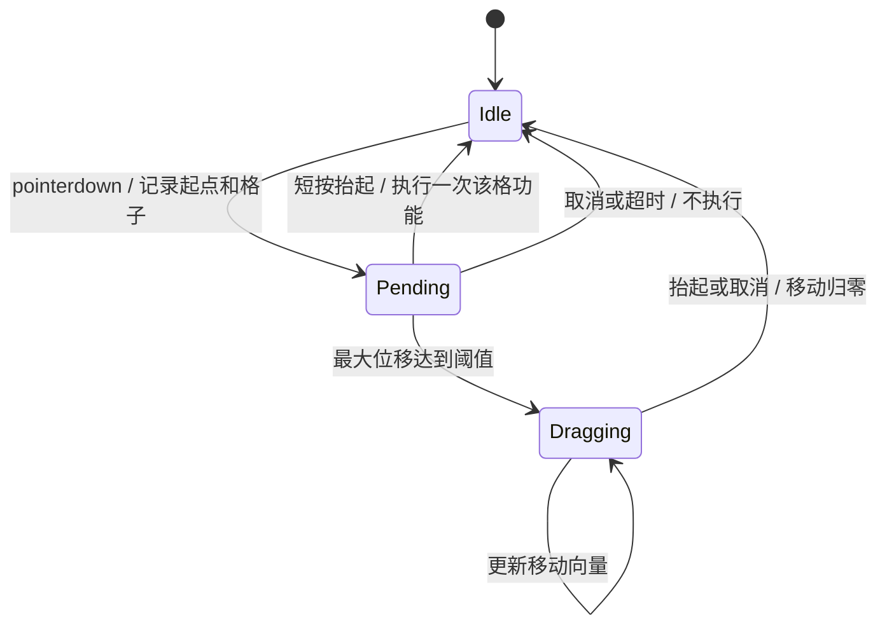

# 双端手柄交互、体感与反馈

> 草案｜2026-10-28｜用户已确认：滑动时移动，单击时点击所在功能。
> 一个玩家本期仅连接手机或 ESP 中的一台，不做多手柄组合。

## 1. 外观与布局

手机默认竖屏，沿用用户草图的设备形态：顶部两颗大主键、四颗状态灯、下方九宫格触控屏。
横屏只做同一布局的响应式适配，不另造第二套按钮配置。主键支持按住与松开，不依赖 click。
ESP 使用交互扩展板双键，四颗顶部灯与两颗按键灯；本体触屏显示九宫格。
两端操作语义一致，尺寸和显示密度分别适配，不强求物理比例相同。

```text
          纯手柄界面；跳跃圆环表示连接状态
       ┌───────────┐   ┌───────────┐
       │ L：瞄准   │   │ R：开火   │
       └───────────┘   └───────────┘
             ●      ●      ●      ●
       ┌───────────┬───────────┬───────────┐
       │ 换弹      │ 切换武器  │ 手雷      │
       ├───────────┼───────────┼───────────┤
       │ 护盾      │  ○ 跳跃   │ 治疗      │
       ├───────────┼───────────┼───────────┤
       │ 翻滚      │ 交互拾取  │ 蹲伏      │
       └───────────┴───────────┴───────────┘
          任意格开始滑动 → 角色移动
```

八个功能的位置为建议默认值，可在后续评审调整；本期只提供一个固定配置，减少布局系统开发。
按现有游戏能力映射：reload、nextWeapon、grenade、shield、medkit、roll、interact、crouchToggle。
中心圆只映射 jump；双键映射 aimHeld / fireHeld。左/右物理按键允许在设置中互换。
切换武器单击轮换，不显示武器名或弹药HUD；本期不做滑动武器轮盘，避免抢占滑动移动语义。
暂停、校准、体感开关在独立设置入口，不占九宫格功能，也不使用「双主键同时长按」。

## 2. 触控状态机：按下不执行功能



1. 按下时记录 pointerId、起点、目标功能、时间、整次手势最大位移；只显示按压预览。
2. 超过拖动阈值即进入移动；起点可以在九宫格任何位置，立刻取消功能预览。
3. 移动方向由「当前位置减起点」决定，距离映射 0–1 速度；不是滑动惯性或松手继续移动。
4. 进入 Dragging 后到本次抬手都保持 Dragging，拖出去再回原点也绝不变点击。
5. Pending 中短按抬起、位移未超阈值且抬起仍在原目标容差内，执行一次功能。
6. 长按静止不产生战斗功能；`pointercancel`、丢失捕获、页面隐藏、屏幕旋转立即归零。
7. 功能区不另监听浏览器合成 click，避免触摸抬起后重复执行；主键采用独立 held 状态。

| 参数 | 初始建议（需真机调手感） |
|---|---|
| 拖动阈值 | 手机约 8 CSS px；ESP 约 8–12 个逻辑像素，按物理屏幕与噪声调节 |
| 点击时长 | 约 40–300ms；更短只过滤明确噪声，不能丢掉真实快速点击 |
| 拖动死区 | 触控有效短边的约 3–5%，到边缘连续平滑变化 |
| 满量程半径 | 触控有效短边的约 20–25%，近边起点用浮动原点保持可达 |
| 方向 | 360° 连续模拟方向，非强制八方向吸附 |
| 抬手 | 下一输入帧移动为零，并立即发送 release |

边缘起手采用有界浮动原点：向边缘推到可用距离后仍能达到满速；不要求手指越出屏幕。
快速甩动即使只收到 down/up，也检查 up 位移并判作滑动，不执行功能。
轻微抖动不会取消正常单击。不能保证所有人零误触，需用实测调整阈值和容差。

## 3. 多点与单点的边界

手机使用 Pointer Events + pointer capture，每根手指独立跟踪。
允许一指在九宫格拖动、另一指短按功能、其余手指按双主键；拖动手指独占移动通道。
第二根手指若越过拖动阈值，不接管移动，也不误发功能；抬手后结束其手势。
系统接管手势或手指移出时也保证主键释放；边缘留安全区，禁用页面滚动与长按选中。

ESP 必须从底层触控驱动验证触点数量及稳定 pointer ID，不凭 LVGL 单指事件推断多点。
已下载 BSP 的 `display.c` 实际调用 CST9220 驱动；部分头文件仍写 CST9217。
采用底层触控适配器，不让渲染框架吞掉第二触点；若驱动能读多个触点，再实现稳定跟踪。

若实机仅支持单点：仍完整支持单指滑动/单击、双实体键和陀螺仪并发。
「保持屏幕拖动时，另一个屏幕触点跳跃」在单点硬件上不能凭软件保证。
该组合默认需要抬手再点；不偷偷保留移动或增加自动奔跑改变用户已确定规则。
若实测确需补足，可将移动中跳跃设为一个可选实体键副操作，但须另行确认，非本期默认。

## 4. 陀螺仪：采用相对转动瞄准

推荐默认：常规体感观察 + ADS 更低灵敏度；用户可切「仅按住瞄准键时体感」以便调整握姿。
平移手柄不移动角色；旋转手柄改变 yaw/pitch；roll 不直接让画面倾斜。
游戏观察角度和手柄绝对地理方位不绑定，避免磁场干扰和南北方向跳变。

处理链：原始 IMU/浏览器事件 → 单位与轴向归一化 → 偏置/姿态估计 → 轻量滤波 →
每发送帧的yaw/pitch角度增量（度）→ WSS → InputRouter转弧度 → 相机。
合并待发送/消费帧时look求和，不能只留最后一个增量；移动/按键保留最新状态。

- ESP 从 BMI270 取角速度和重力方向；使用 BSP 的传感器启动与读取接口。
- 手机优先 DeviceMotion rotationRate，缺失时用 DeviceOrientation 差分构造相对转动。
- 浏览器角速度按规范是 deg/s；统一转为 rad/s，不凭 alpha/beta/gamma 字母猜世界轴。
- 显式定义设备坐标、握持朝向、screen.orientation 变换和游戏坐标；以已知轴动作标定正负。
- 通过四元数处理朝向与角度跨 ±180°，最后提取相机需要的相对 yaw/pitch。
- ESP 用重力估计修正俯仰漂移；偏航无可靠绝对参考会漂移，提供自然重校准与离合。
- 不默认用 BMM150 稳定偏航，磁吸件、扬声器和结构会影响读数。

首次开始控制要求静止约 1–2 秒；检测方差/加速度合格才采用零偏，移动中不误校准。
校准失败允许重试或先用触控观察，不假装已完成。
设备感应更新初始目标 ESP 200Hz、网络 60Hz、手机按浏览器实际事件频率；均需实测。
滤波初始采用轻量自适应低通/One Euro 思路，减少静止抖动并保留快速转向；参数需实验。
避免设备端和游戏端叠加重滤波；游戏端只做有限平滑，不做长时间惯性追随。

## 5. 手感细节

- yaw 连续转动；pitch 沿用当前第一人称约 ±1.25rad、第三人称约 -0.5～0.38rad 约束。
- 常规/ADS 分别设灵敏度，ADS 降低微调倍率，映射到当前游戏武器状态。
- recenter 只重设手柄基线，不把游戏镜头突然拉回正前方。
- 横竖屏变化、权限恢复、重连、时间间隔异常时重新设基线，丢弃跨断点积累角度。
- 「仅瞄准时体感」模式松开左键冻结体感，可把手移回舒适姿势，再按住继续。
- 没有 IMU 或拒绝权限时，设置中切换「触控观察」：主键区下方显示独立观察条。
- 观察条只用于此降级模式，九宫格仍保持滑动移动/单击功能；不把移动滑动改成观察。

## 6. 手机权限与页面

新建顶层 `/controller` 独立页面，不嵌在游戏 iframe，不加载 Three.js、角色资源或账号壳。
扫码后无需登录，以bindKey+短期token建立WSS直接绑定；不再游戏端二次批准。
「开始控制」是明确的用户点击：能力检测后请求所需 DeviceMotion / DeviceOrientation 权限。
使用 HTTPS / WSS；处理 requestPermission 不存在、拒绝、数据为 null 和长时间无事件。
规范规定安全上下文与用户授权要求，但具体实现必须按浏览器检测，不能从 UA 保证支持。
证据：[W3C Device Orientation and Motion](https://www.w3.org/TR/orientation-event/)。

支持 iPhone Safari / Android Chrome 与各自主屏页面；内嵌浏览器单独检测并提示转系统浏览器。
Screen Wake Lock / 全屏为能力增强，失败时手柄仍能使用；隐藏或锁屏立即释放输入。
音效需用户激活后才能播放；iOS 等无 Web Vibration 时用视觉/音效替代，不宣称统一震动支持。
设置入口包含体感开关/模式、灵敏度、左右主键互换、重新校准、断开和输入自检。

## 7. 状态反馈与视觉规范

沿用游戏深蓝灰、暖金强调和前线战术风格；图标加短中文，避免小字说明占满屏。
两端都删除应用Logo/标题/连接文字，手机删除生命与弹药HUD，只做手柄功能界面。
Mosaico屏幕只留九宫格；手机保留双主键、四灯与九宫格；连接状态用跳跃圆环表示：绿在线、红离线。
默认九宫格底图弱化，触摸后突出当前操作；拖动时显示浮动方向环，格子功能不闪烁触发。
治疗/护盾/手雷用数量和冷却蒙层；不可用时给短反馈，不让按钮看起来失灵。

| 输出 | 默认行为 |
|---|---|
| 顶部四灯 | 保留功能反馈，不显示生命段数；连接状态统一由跳跃圆环表达 |
| 两颗按键灯 | 瞄准按住与开火可用状态，低亮度，避免刺眼 |
| 受击 | ESP 短促触觉 + 红色边缘脉冲；手机按真实能力降级 |
| 换弹 | 可给短确认；不展示弹药数值或HUD，不让震动覆盖连续瞄准 |
| 胜负/死亡 | 一次性效果，过期反馈不在重连后补播 |
| 电量/网络 | 低电与异常明确提示；延迟数值来自真实测量，不硬编码演示值 |

振动期间评估 IMU 噪声；必要时减小马达强度/滤掉受污染采样，不用后坐力强震破坏微瞄准。
断线后跳跃圆环立即变红并停控；不显示生命灯效，触觉反馈限频、限幅、可中断。
