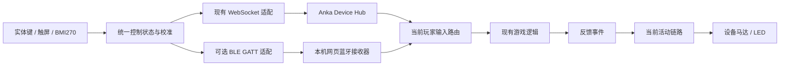

# Mosaico 自定义 BLE GATT 直连电脑方案

> 2026-10-29｜独立后续方案，暂不实现。
> 用户本轮仅要求记录方案；未授权本轮开发、安装或切换设备连接方式。
> 本文的服务划分、编码和参数属于设计建议，不是已实现接口或实测结果。

## 1. 定位与范围

为现有 ESP-Mosaico 手柄增加可选的蓝牙直连模式：设备作为 BLE 外设和 GATT Server，
运行 Anka 游戏的电脑浏览器作为 Central 和 GATT Client，通过 Web Bluetooth 双向通信。
高频输入直接进入本机游戏网页，受击等反馈直接返回 Mosaico，不经过远端设备输入中继。
游戏现有联机通信、角色权限和技能判定继续使用原有系统。

现有 WebSocket 模式继续保留；手机网页手柄继续使用 WebSocket。
一个玩家只有一台活动设备、一个活动输入来源。首版不同时用 BLE 和 WS 发送同一份输入，
不自动双发或无感切换，避免重复射击、移动叠加和姿态基准冲突。

本文不把标准 BLE HID/Gamepad 模式列入本次待实施范围，也不增加通用 Steam 手柄兼容承诺。
当前线上/本地功能及实际接口仍以 [Device v1](../../../docs/DEVICES.md) 为准。

## 2. 为什么选择自定义 GATT

| 能力 | 标准 BLE HID 经浏览器 Gamepad API | 自定义 GATT 经 Web Bluetooth |
|---|---|---|
| 双主键、中心拖动移动 | 可映射按钮、摇杆 | 直接保留当前控制语义 |
| 顶排横滑转身 | 需要处理转角与摇杆转速的差异 | 直接传累计转角快照 |
| 完整体感姿态 | 标准网页接口没有通用四元数/陀螺仪字段 | 自定义传输完整姿态 |
| 震动与灯光 | 依赖系统、驱动和浏览器暴露能力 | 自定义反馈命令，由固件执行 |
| 控制其他现成游戏 | 更适合，但仍需验证兼容性 | 对方需要接入自定义协议 |

限制主要在系统到网页的接口，不在陀螺仪能否通过蓝牙传输。
HID 可以包含体感报告，但不能据此假定 Gamepad API 会向网页暴露报告内容。
把姿态映射为额外轴需要专门约定和跨系统验证；映射为右摇杆转速则会改变现有手感。

GATT 可以保留当前完整控制语义，但浏览器支持、权限及硬件适配仍有前提。
传输方式改变不会自动修复六轴 IMU 的航向漂移，必须保留现有校准和融合逻辑。

## 3. 共用控制核心，分开传输适配

图中的两条输入路线为二选一，不是并发发送。
复用现有实体键映射、九宫格、滑动轨迹、A/B 校准、姿态融合、灯光及马达驱动。
新增 GATT 编解码、浏览器蓝牙接收器，以及 Device 生命周期的本地传输适配。
不为蓝牙模式再编写一套角色控制、技能判定或姿态解算规则。

## 4. 首次连接、扫码与鉴权

建议流程：打开 ESP 蓝牙手柄模式 → 扫描当前玩家的配对码 → 游戏网页点击
“连接蓝牙手柄”并在浏览器选择设备 → 交换扫码绑定信息 → 服务确认绑定 →
设备显示绑定成功反馈 → A+B 按住约 800ms 后全部松开确定握姿 → 手柄模式。

扫码用于指定玩家和游戏目标；浏览器设备选择用于授予本机网页访问蓝牙的权限。
两者职责不同，扫码不能绕过首次 Web Bluetooth 设备选择和用户操作要求。
不新增无意义的 profile、capabilities 或额外必填握手层；只补齐蓝牙传输所需信息。

User / Share / Device 三套鉴权继续独立：

- User 或 Share 确定当前网页可以控制的玩家及房间，不能借蓝牙越权控制其他玩家。
- 设备提供二维码中的短期 bindKey/token，服务端原子检查目标、有效期和单设备占用。
- 成功后建立独立 Device 会话；蓝牙地址、设备名称和浏览器访问许可均不能替代 Device 凭证。
- 扫码凭证、重连凭证只保存在本次应用/页面会话内，不放进 BLE 广播或普通日志。

本地 GATT 绑定需要设计 Device Hub 的新传输适配；现有 WS join 不能直接视为已经支持。
建议由已授权接收网页桥接设备绑定材料，服务确认后经 GATT 将结果交给设备。
页面不根据扫码 URL 向任意第三方转发 User/Share 凭证；服务继续验证绑定目标和来源。
具体控制接口、重连凭证交付及绑定关联字段在后续实施前冻结，本轮不新增路由。

高频控制数据可绕过服务中继，但服务仍管理玩家归属、绑定占用、撤权和设备会话期限。
保留接收端控制通道/授权检查；授权失效、离房、解绑或控制通道失效时停止接受设备输入，
按现有生命周期处理，不以“蓝牙仍连接”为理由继续控制。

## 5. GATT 服务建议

使用独立的 Anka 控制器自定义 Service；UUID、属性和字节布局尚未冻结。

| 逻辑通道 | 方向与属性建议 | 内容 |
|---|---|---|
| Input | ESP → 网页，Notify | 完整输入快照、单次功能动作 |
| Output | 网页 → ESP，Write | 震动强度/时长、灯光状态 |
| Control | 双向，Write + Notify | 绑定结果、校准状态、版本、错误及诊断 |

未绑定成功前不接受游戏控制和普通输出命令，只允许必要的绑定与状态交换。
关键控制命令需关联请求并确认结果；GATT 写入完成不等于马达动作或游戏技能已经生效。
蓝牙服务交互与系统配对/加密策略需要随 S31 和目标电脑实测确定，不能只靠设备名称识别。

## 6. 业务协议与编码

GATT 传输字节，不要求 JSON，也不自带 Anka 游戏协议。
建议共用现有业务字段，在传输边界选择编码：

| 数据 | 可行性验证阶段 | 后续运行编码建议 |
|---|---|---|
| 连续输入、单次 action | JSON，先核对语义 | 紧凑二进制 |
| 震动、灯光 | JSON | 简短二进制 |
| 设备信息、诊断 | JSON | 低频 JSON |
| 现有 WebSocket | 保留 JSON | 保留 JSON |

网页解码后得到与现有接收器相同的控制对象，再进入共享输入路由。
调试面板展示解码后的 JSON，并允许用 JSON 发测试命令；二进制数据可同时显示十六进制。
调试信息隐藏配对及重连秘密，不把无效帧传给游戏。

### 6.1 必须保留的输入语义

| 字段 | 含义与约束 |
|---|---|
| version / type / seq | 编码版本、消息种类、当前连接序号；具体长度待冻结 |
| move.x / move.y | 完整二维移动快照；右正、前正，向量长度不超过 1 |
| buttons.fire / aim | 保持状态；实体左开火、右瞄准，不依赖松开边沿才能停控 |
| turn / turnTotal | 兼容圆周角及未取模完整累计转角，度，右正；不是角速度，沿用现有最新快照语义 |
| pose.id / pose.q | 校准世代与完整单位四元数，顺序 w/x/y/z；取最新值，不逐包累加 |
| action | 现有九宫格单次功能，保留一次性执行语义 |

顶排横滑沿用最新正典：半格激活，门槛后每格180°，同次按住可实时反向，停手停止、抬手保留转角。
中心拖动仍移动，短点仍跳跃；不因切换传输改变手势或功能映射。
体感使用相对本次校准的完整姿态，不宣称提供相对磁北的绝对航向。
若兼容旧 look 增量，需要单独遵守求和规则，不能与完整 pose 重复应用。

### 6.2 二进制编码原则

- 高频完整输入预计为几十字节，具体长度取决于最终字段，不在本阶段承诺固定尺寸。
- 按键可编码为位图；移动、转角的数值范围、单位、精度必须写入最终协议。
- 四元数建议保留 float32，与当前固件计算精度一致，不为缩包直接改成低精度角度。
- 明确字节序、帧长度、类型编号、浮点校验、序号回绕和未知版本处理。
- 拒绝非法长度、非有限数、越界值和无效姿态；连接中只采用约定编码，不能靠猜测解析。

### 6.3 MTU 与分帧

ATT MTU 需要协商；常见默认 MTU 为 23 字节，普通 Notify 的应用数据上限为 MTU−3。
不能把 MTU、单个链路层包长度、完整业务帧长度当作同一个值。
优先让高频帧适配实际协商的单次通知容量；JSON 验证或 MTU 不足时必须有明确分帧。
分帧需要总长、帧关联和片段顺序，限制缓存及组帧时间；帧完整且有效后才交给游戏。
丢弃不完整旧快照，保持输入 watchdog；动作不因重组、重连而重复执行。

## 7. 断线、重连与输入释放

- 输入超时沿用当前 150ms 目标，在本机接收端和游戏输入层执行；ping 不维持开火。
- 断线、页面隐藏/暂停、失去授权或触摸取消，清空移动和保持按键，不重放旧动作。
- 设备应用存续且授权有效时保持可重连；网页运行且许可有效时持续退避重试。
- 重连后重新获取 GATT 服务/特征并订阅通知，不复用已经失效的特征对象。
- 恢复先同步中立完整快照，再恢复输入；保留有效校准与 turn，防止重新叠加旧转角。
- 页面关闭、系统休眠、权限撤销或后台暂停时，不能保证浏览器持续重连。
- 会话撤销或凭证过期属于业务状态，不能用无限蓝牙重试恢复控制权限。
- 设备正常关机/应用重启重新绑定；不恢复已撤销的玩家关系。

BLE 与 WS 模式切换前，先释放原输入并结束原活动来源；新来源建立有效绑定后才启用。
浏览器记住的蓝牙许可不等于 Device 绑定永久有效，权限保留情况必须实测。
跳跃绿框仍表示已绑定且可控制，红框表示不可控制，不能只用底层 BLE 连接判断在线。

## 8. 浏览器、硬件及部署边界

首轮验证限定 macOS/Windows 的目标 Chrome/Edge，逐一记录版本和结果；Android Chrome 后验。
当前 Safari/iOS Safari 没有原生 Web Bluetooth 支持，不能承诺用普通 Safari 直接接收 ESP GATT。
“iPhone 作为网页手柄控制电脑”仍可走现有 WS，与“iPhone 浏览器作为 BLE 接收端”分开判断。
普通网页的 Web Bluetooth 主要承担 Central 角色，不能据此让手机网页变成 BLE 手柄外设。

接收网页需要安全上下文：生产使用可信 HTTPS，开发可用受信任的 localhost。
现有 LAN HTTP 可以继续使用 WS 手柄；不能假定 http://局域网IP 同时能使用 Web Bluetooth。
首次 requestDevice 必须由点击等用户操作触发，不能在扫码后静默绕过设备选择。

ESP32-S31 硬件具备 BLE，但不等于 Arduino 手柄库可以原样接入当前原生 ESP-IDF 工程。
ESP32-BLE-Gamepad 当前 CI 未覆盖 S31，NimBLE-Arduino 明确区分原生 IDF 版本。
自定义 GATT 优先评估当前原生 IDF 的 NimBLE 能力，不为复用 HID 包直接引入整套 Arduino。
先验证本项目锁定 SDK、蓝牙初始化、内存与任务资源、Vibe 生命周期及 Wi-Fi 共存。
目标仍是保留系统 Wi-Fi、Vibe 和现有 Ideas 的应用升级；具体组件配置需验证，不承诺零改动接入。

## 9. 延迟比较与测量计划

当前代码：IMU 以独立 5ms 任务更新；连续 WS 输入目标间隔 17ms，5ms 网络轮询会增加调度等待；
实体开火/瞄准变化优先发送，实体键另有防抖和模块读取开销。上述均不是端到端实测延迟。
GATT 可尝试请求 7.5～15ms 连接间隔，实际值由双方协商并记录；连接间隔不等于画面响应时间。

| 场景 | 判断 |
|---|---|
| Anka 服务与游戏电脑同机、Wi-Fi 良好 | WS 路径已短，GATT 是否更快需实测 |
| Anka 服务在远端 | GATT 高频输入省去远端中继，有减少延迟的机会 |
| 标准 HID 对比自定义 GATT | 无线链路相近，上层路径不同，不能预设固定毫秒差 |
| 60 FPS 游戏 | 等待下一帧可增加 0～16.7ms，另有渲染、呈现和显示开销 |

使用相同硬件、采样率、姿态滤波、游戏帧率和距离比较 WS/GATT；分别测试按键、移动、体感及震动。
记录中位数、P95/P99、帧间隔、卡顿和断线次数，并覆盖 Wi-Fi 干扰与共存场景。
链路回显测得的是 RTT，不能直接冒充单向延迟或完整按下到画面响应。
设备与电脑时钟不同，不能直接相减；单向测量需校时并给出误差，端到端可用高速摄影或硬件触发。
手势跨一格的主动门槛与网络延迟分别统计，不通过取消门槛改变比较条件。
本阶段无 BLE 实测数字，不宣称比局域网 WS 快一倍，也不承诺固定低延迟或续航提升。

## 10. 后续开发与验收门槛（未开始）

| 阶段 | 内容 | 通过条件 |
|---|---|---|
| P0 可行性 | 原生 S31 GATT、网页连接、按键/姿态通知、一次反向震动 | 双向实机链路通，Vibe/系统 Wi-Fi 正常 |
| P1 可玩闭环 | 绑定桥接、JSON 验证、校准、移动/转身/动作、完整姿态 | 当前手势与回正语义保持一致 |
| P2 编码与生命周期 | 紧凑编码、MTU、断线释放、持续重连、撤权及单来源 | 无卡键、动作重放、转角跳变或越权 |
| P3 对比验收 | 延迟/抖动、共存、长时间使用、目标浏览器、功耗 | 有可复现数据，再决定是否作为常用模式 |

粗略工作量参考：P0 约 0.5～1.5 工作日，验证通过后的基础闭环约 1～2 日，
完整适配与稳定性约再 2～4 日；属于前述讨论的估算，SDK/系统适配问题可能明显延长。
实施前先冻结 UUID、编码布局、鉴权桥接及超时策略；新增依赖要锁版并复核许可证。
后续若实施，再更新架构正典、范围、协议、版本和测试证据，本轮不提前标记任何阶段通过。

## 11. 参考与现状

以下为 2026-10-29 讨论时查阅的公开来源；动态主分支未作为本项目依赖锁定。

- [Chrome Web Bluetooth](https://developer.chrome.com/docs/capabilities/bluetooth)：Central、通知/写入、安全上下文、用户操作和重连。
- [W3C Gamepad](https://www.w3.org/TR/gamepad/)：网页标准按钮/轴/反馈接口的边界。
- [浏览器兼容性原始数据](https://github.com/mdn/browser-compat-data/blob/main/api/Bluetooth.json)：Safari、iOS Safari 等接收端支持情况。
- [ESP32-S31 BLE 连接指南](https://docs.espressif.com/projects/esp-idf/en/latest/esp32s31/api-guides/ble/get-started/ble-connection.html)：连接事件、参数及 MTU。
- [ESP32-BLE-Gamepad](https://github.com/lemmingDev/ESP32-BLE-Gamepad)：标准手柄路线对照，不作为自定义 GATT 必需依赖。
- [NimBLE-Arduino](https://github.com/h2zero/NimBLE-Arduino) 与 [esp-nimble-cpp](https://github.com/h2zero/esp-nimble-cpp)：Arduino/IDF 的适配边界，未声明已通过本设备验证。
- 项目现有语义：[Device v1](../../../docs/DEVICES.md)、[中心移动与顶排转身](08-center-move-top-row-turn.md)。

本轮仅新增本方案文档；未添加蓝牙依赖、GATT 服务、协议代码或网页入口，未构建/刷写/操作设备。
