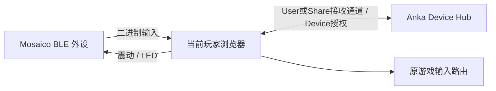

# BLE GATT Gamepad v1

2026-10-30 · 独立应用 `device/anka-gatt-gamepad` 0.1.0；原 WS 固件与手机手柄保留。
本文件为实现契约；历史方案在 `doc/mosaico/design/09-ble-gatt-direct-controller.md`，实际验证另记。

## 路径与鉴权



高频输入、反馈均为本机 GATT 直连，不经过服务转发；房间联机通信保持原样。
已有 `devices` infra 插件提供控制平面，不新增第二套用户或邀请鉴权。
用户点击「连接蓝牙手柄」选择外设，当前已鉴权页面确定玩家和游戏；BLE无需二维码、Wi-Fi或host配置。
浏览器选择不能静默绕过。手机/WS手柄继续扫码。
设备仅广播服务 UUID 和通用名称；一次性本机配对证明、Device 凭证均不出现在广播和普通日志。

接收网页沿用 `/api/devices/{user|share}/{app}/receiver/ws`，必须通过原 Cookie/邀请授权和 Origin 校验。
新增消息由此通道处理，`requestId` 原样关联回复：

| 请求 | 字段 | 结果 |
|---|---|---|
| gatt_bind | 无必填额外字段 | 当前已鉴权 receiver 创建单设备 GATT 绑定；网页选择的外设提供本机配对证明 |
| gatt_resume | deviceId, token（Device resumeToken） | 同玩家、同游戏、相同 Device 凭证恢复 |
| gatt_lease | 无额外凭证 | 仅当前绑定的 receiver 通道可续约 |
| gatt_detach | 无额外凭证 | 暂时断开来源、释放输入，保留绑定 |

成功回复 `gatt_authorized`，含 deviceId、leaseMs=1500、active；bind/resume 另含 resumeToken。
错误 `gatt_error`，含 code、message；撤权发 `gatt_revoked`。错误不会把有效游戏接收通道一并踢下线。
WS Device 凭证不能作为 GATT 恢复，GATT Device 也不能走 WS join；一个玩家一个绑定。
BLE不传服务器地址、不发起扫码请求；后端归属直接取当前User/Share receiver，不允许客户端指定另一个玩家。
兼容旧开发包时，携带bindKey/token的gatt_bind仍要求精确receiver及QR原子校验；新包不使用此路径。

## 服务与特征

所有 UUID 使用标准128位格式：

| 项目 | UUID | 属性 |
|---|---|---|
| Service | `9f924000-6db5-4e64-a7c3-31891b2a0000` | 自定义主服务 |
| Input | `9f924001-6db5-4e64-a7c3-31891b2a0000` | Notify |
| Output | `9f924002-6db5-4e64-a7c3-31891b2a0000` | Write with response，要求加密 |
| Control | `9f924003-6db5-4e64-a7c3-31891b2a0000` | 加密 Read / Write with response，Notify |

原生 NimBLE Secure Connections / Just Works；蓝牙密钥由独立蓝牙命名空间保存，Device 会话秘密仍只在 RAM。
Just Works 不是抗主动中间人证明；玩家归属由已鉴权网页及独立 Device 体系确认，不能凭蓝牙名称或配对关系越权。
最多一个 Central；初次配对按操作系统提示完成。普通页面刷新不会重新获得 Device 内存凭证。
首次绑定控制帧只有通过加密Read取得的本次应用配对秘密匹配才接受；输出需要有效租约。换 Central 立即失效原租约，不继承旧玩家输入。

## 分帧

所有 Notify / Write（包括 Control JSON）都带8字节头，小端：

| 偏移 | 类型 | 含义 |
|---|---|---|
| 0 | u8 | magic=0xA7 |
| 1 | u8 | version=1 |
| 2 | u16 | packetId，按特征重组 |
| 4 | u16 | 负载offset |
| 6 | u16 | 完整负载总长度1..2048 |
| 8 | bytes | 当前片段负载 |

顺序必须连续、packetId和total一致，片段间隔超过250ms丢弃；offset0替换旧残帧。
完整且业务校验通过后才能交给游戏。组帧不重放旧动作。
ATT MTU默认23，可用容量20；网页每次写最多20字节（负载12），无需猜测浏览器MTU。
ESP Notify用协商MTU−3、上限244。44字节输入在默认MTU分4段，足够大MTU时1段。
Control **Read** 是原始UTF-8 JSON（不分帧，由ATT长读处理），上限512字节。

## 二进制输入

输入快照固定44字节，无量化、小端；seq为应用运行期间递增u32，重连不重置。

| 偏移 | 类型 | 字段 |
|---|---|---|
| 0 | u8 | version=1 |
| 1 | u8 | type=1 |
| 2 | u32 | seq（非0） |
| 6 | f32 | move.x，右正 |
| 10 | f32 | move.y，前正；向量长度≤1 |
| 14 | f64 | turnTotal，度，右正、未取模累计值 |
| 22 | u32 | pose.id，校准世代 |
| 26 | f32×4 | pose.q，w/x/y/z，单位四元数 |
| 42 | u8 | bit0=fire、bit1=aim，其余0 |
| 43 | u8 | pose存在0/1 |

接收器还原原游戏 JSON `{type:input,move,look:{yaw:0,pitch:0},buttons,turn,turnTotal,pose}`。
turn由turnTotal推导为[-180,180)；实际优先完整累计值，避免快滑跨180°及圈数丢失。
pose只应用最新相对姿态，不逐包叠加；六轴IMU没有磁北参考，长期航向漂移仍是物理边界。
拒绝长度、版本、未知位、非有限数、移动越界、turnTotal超±1e9、无效id和非单位姿态。
重复序号丢弃；连接先发中立快照，游戏保持原150ms输入watchdog。

单次动作7字节：version1、type2、seq u32、action u8。
action顺序：0 reload，1 next_weapon，2 grenade，3 shield，4 jump，5 heal，6 roll，7 interact，8 toggle_crouch。
动作仍由游戏判断技能可用性；蓝牙传输ACK不代表技能已经执行。

## 输出

反馈10字节：version1、type3、seq u32、event u8、strength u8、durationMs u16。
event顺序：shot、damage、reload_complete、death、win；strength=0..255映射0..1，马达驱动再限到0.6，时长最多150ms。
LED26字节：version1、type4、seq u32、durationMs u16、18字节RGB（6组）；最多2000ms，结束回正常状态灯。

网页调试输入示例（运行时编码为二进制）：

```json
{"type":"feedback","event":"damage","strength":0.4,"durationMs":100}
```
```json
{"type":"leds","durationMs":500,"rgb":[32,0,0,0,32,0,0,0,32,16,16,16,0,16,16,32,16,0]}
```

每条关键命令收 `control_ack {seq,status:applied|rejected}`，网页等待最多2秒；applied代表固件已接受输出，不代表传感器测到了马达动作。

## Control JSON 与生命周期

Read回复 `{type:pairing,bootId,pairingKey,deviceId}`；pairingKey为本次应用随机证明，只能加密读取，绑定后清空对外内容。bootId区分应用重启。
设备开机即显示蓝牙等待页，不启动相机。已绑定/授权撤销提示回原页面或重启应用重新连接。

```json
{"type":"bound","seq":1,"token":"local pairingKey","resumeToken":"Device secret","deviceId":"dev_…","leaseMs":1500,"active":false}
```
```json
{"type":"lease","seq":2,"resumeToken":"Device secret","leaseMs":1500,"active":true}
```
```json
{"type":"revoke","seq":3,"resumeToken":"Device secret"}
```

bound仅首次可用，校验本机配对秘密；lease/revoke要求Device秘密；不能靠再次bound覆盖原绑定。
网页约500ms续服务授权并转为设备租约；leaseMs范围100..1500。授权无效即本机停止输入，最迟租约到期设备释放。
页面隐藏/暂停传active=false、释放保持输入；恢复需中立状态重新接管。失去服务控制通道同样停控。
蓝牙断线立即释放，原页面持续退避重连（上限5秒）；重新发现服务/特征、重订阅、验证bootId与Device授权。
重连保留校准和累计转角，旧动作不重放；设备应用重启必须重新连接绑定。
用户解绑、离房、父User/Share撤销不可用无限重试恢复；应用本次会话不更换绑定，重启应用再绑定。

## 验证与边界

- 便携 C 编码样本被 JS 实际解码；默认/扩展MTU、错片/残片、姿态与累计转角均有检查。
- Python服务测试覆盖精确玩家、User/Share、传输隔离、唯一绑定、租约、断开及撤权。
- 浏览器适配测试可模拟特征，但不能冒充真实蓝牙；实机脚本单独记录真实radio/IMU与USB触点注入来源。
- macOS/Windows Chrome/Edge需逐个平台实测；Safari/iOS不接收GATT。LAN HTTP继续支持原WS，但蓝牙要求可信HTTPS或localhost。
- 不宣称固定端到端毫秒数。输入目标17ms、请求连接间隔7.5–15ms，帧等待和系统调度另计；RTT不能当单向或完整按键到画面的延迟。

参考：[Chrome Web Bluetooth](https://developer.chrome.com/docs/capabilities/bluetooth)、[官方 NimBLE安全示例](https://github.com/espressif/esp-idf/tree/master/examples/bluetooth/nimble/bleprph)。实际构建使用本项目锁定SDK，不跟随网页master升级。
