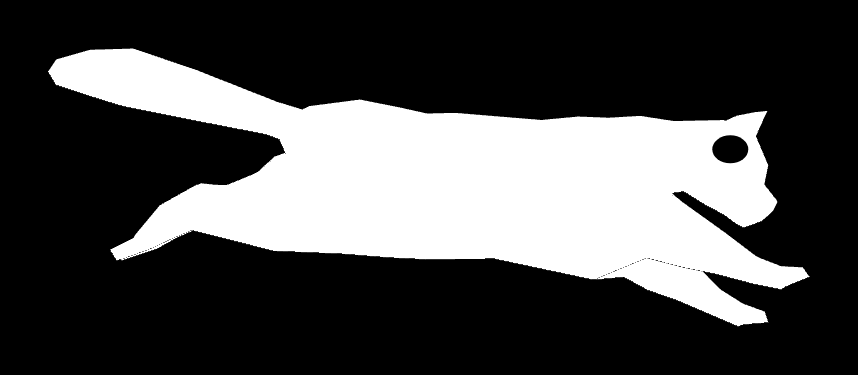
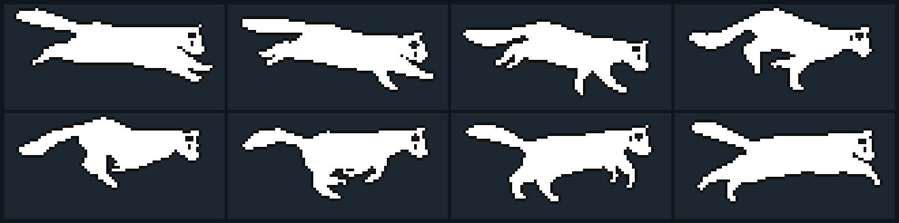

# 像素猫跑酷 · Cat Runner

纯原生 Canvas 像素横版跑酷，入口 `index.html`。

## 这次的 3D 跑步动画

白猫不再是手绘三帧，而是从 3D 模型 `cat_rigged.glb` 的奔跑 clip 采样 8 帧；跳跃也换成 3D 帧：

1. 黑色背景，正交侧视，大图渲染 **1600 × 680**，确保整只猫和四只脚都在画面里；
2. 按整组帧的可见像素范围固定裁剪，不再逐帧上下挪动整只猫（避免“半空悬浮”）；
3. 压成 **80 × 34** 像素格，底部再补 4 行透明脚位；游戏绘制时用固定的脚底偏移对齐地面；
4. 全身纯白填充，只保留黑色描边，并加一颗纯黑眼睛；不画鼻子等颜色细节。
5. 跳跃为 4 帧 3D 姿态 + 起跳继承当前奔跑帧 + 落地过渡，全部纯白 + 黑边。

素材：

- `assets/cat-run-frames/frame-0.png` … `frame-7.png`：1600 × 680 黑色背景高清侧视逐帧图
- `assets/cat-run-preview.png`：裁掉多余黑边的高清预览，四只脚完整可见
- `assets/cat-run-hi-sheet.png`：8 帧高清接触表
- `assets/cat-run-3d-sheet.png`：8 帧像素接触表
- `js/catFrames.js`：运行时使用的 80 × 34 像素点阵（自动生成）




## 像素道具

在原有木箱、垃圾桶、易拉罐、鸟、井盖基础上新增：

- **水管**：横跨路面的粗水管，红色法兰/阀门，跳过去；
- **老鼠**：地面上的金色老鼠奖励，拾取 +5 金币（结算分数 +50）。

## 操作

| 操作 | 键盘 | 手机 |
| --- | --- | --- |
| 跳跃 / 可变高度 | Space、↑、W | 左右下角「跳」按钮，或直接点画面 |
| 重开 | R | 失败面板 / 点按画面 |
| 暂停 | P / Esc | 右上暂停按钮 |
| 静音 | M | 右上音量按钮 |

桌面和移动端共用同一套物理与输入状态；触控按钮贴在屏幕左下/右下角，
适配手机横屏双手拇指，使用 Pointer Events，支持按住跳得更高、指针取消/离开时释放。

手机打开会自动横屏：优先调用 `screen.orientation.lock('landscape')`（Android 全屏下生效），
不支持时（iOS / 系统锁定方向）退化为把整个界面旋转 90° 的 CSS 兜底，两种情况下都是横屏布局。

## 本地预览

```bash
cd plugins/cat-runner
python3 -m http.server 8765
# http://127.0.0.1:8765/
```