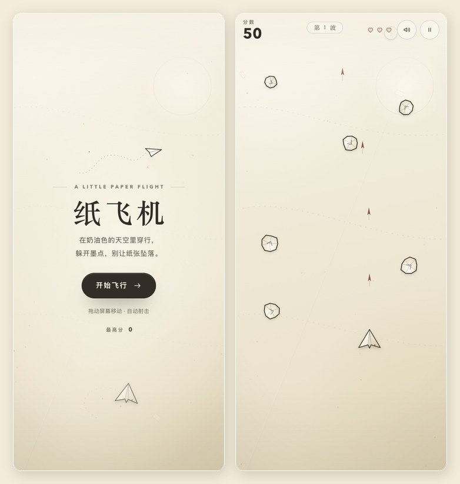

# 纸飞机 · Paper Flight

奶油白纸感的竖版飞行射击小游戏，跑在 ANKA 的 `page` 插件里。
纯 Canvas + WebAudio，运行时不加载外部图片、字体或第三方脚本。



## 玩法

驾驶一架折纸飞机，躲开从上方飘落的纸团、墨点和信封，自动射击把它们击落。

- 连续击落会累积「连击」，每 5 连击提升一次得分倍率（最高 ×5）。
- 金色折纸星星：获得 9 秒三连射。
- 红色纸心：恢复 1 点生命（最多 5 点）。
- 每 18 秒进入下一波，敌机速度和密度逐渐提高。
- 最高分保存在浏览器 `localStorage`。

## 操作

| 动作 | 电脑 | 手机 |
| --- | --- | --- |
| 移动 | 鼠标移动 / `←` `→` `↑` `↓` / `WASD` | 在画面上拖动 |
| 射击 | 自动 | 自动 |
| 暂停 / 继续 | `P` 或右上角按钮 | 右上角按钮 |
| 静音 | `M` 或右上角按钮 | 右上角按钮 |
| 开始 / 重开 | `Space` / `Enter` / 按钮 | 按钮 |
| 失败后重开 | `R` | 按钮 |

触摸拖动时，飞机会落在手指上方一点，避免被手指遮住。

## 本地预览

```sh
cd plugins/paper-plane
python3 -m http.server 8899
# 打开 http://127.0.0.1:8899/
```

## 在 ANKA 中安装

这是 `kind: page` 的静态插件，入口为 `index.html`，不需要后端或构建步骤：

1. 在 ANKA 的「插件」页找到「纸飞机」；
2. 点击安装；
3. 从 dock 打开，或访问 `/app/paper-plane`。

移动端由宿主提供全屏 iframe 与安全区；页面自身已处理 `pointer`、触摸手势与横竖屏布局。

## 文件

```
plugins/paper-plane/
├── plugin.json     # manifest v2，page 类
├── index.html      # 页面结构 / 开始、暂停、结算面板
├── style.css       # 奶油纸色、纹理、响应式排版
├── game.js         # 游戏循环、输入、碰撞、Canvas 绘制、WebAudio
├── preview.jpg     # 预览图（不参与运行）
└── README.md
```

## 设计说明

- **色板**：奶油纸底 `#f9f3e7` → `#eee2cb`，墨色 `#3b342b`，陶土红 `#bd5b3c`，旧金 `#bd9148`。
- **纸张质感**：CSS 内联 SVG `feTurbulence` 颗粒、对折光带、边缘暗角；所有纸飞机、纸团、信封、墨点都是 Canvas 手绘路径。
- **轻量**：运行时无图片资源；粒子数量和画布 DPR 都有上限，手机端同样以 60fps 为目标。
- **声音**：WebAudio 合成短音，首次点击「开始飞行」后才创建 AudioContext，避免移动端自动播放限制。
- **可访问性**：按钮有 `aria-label`，分数/连击/提示有 `aria-live`，尊重 `prefers-reduced-motion`。

发布前请按 ANKA 约定 bump `plugin.json` 的 `version`。
